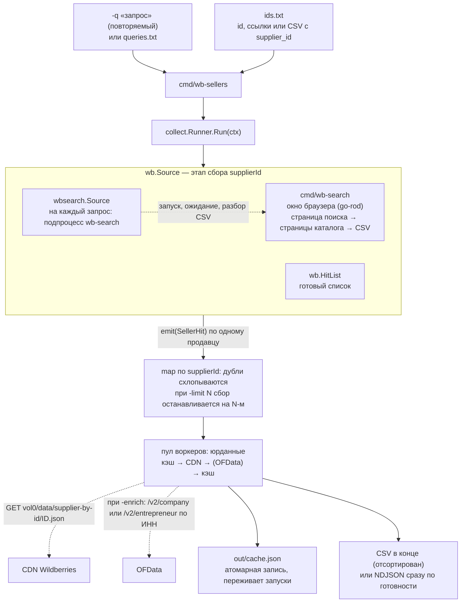
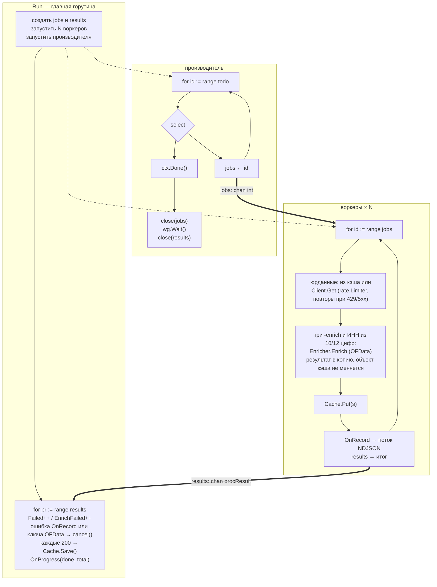
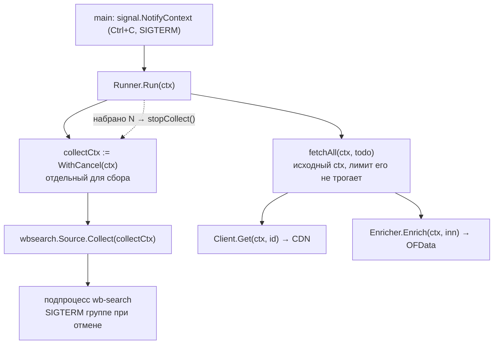
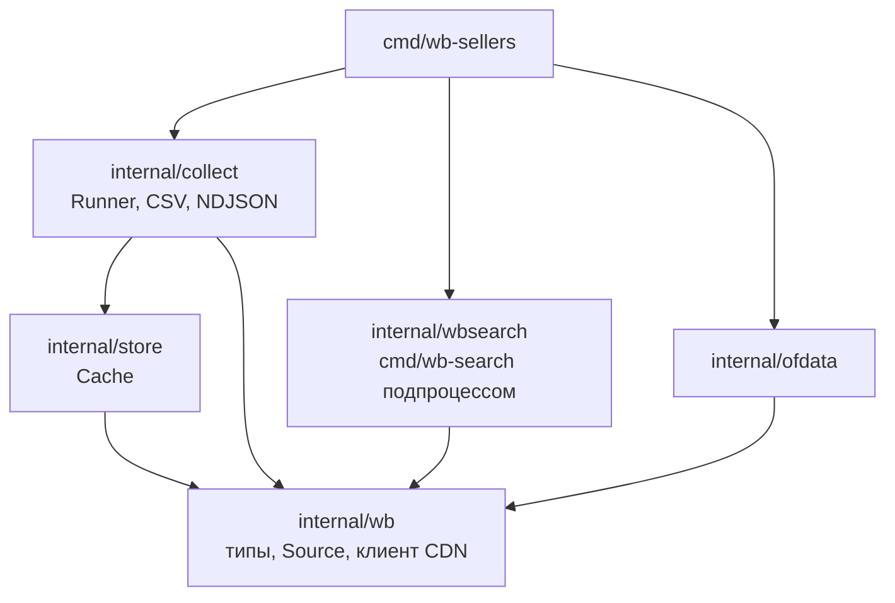

# wb-sellers

Собирает юридические данные продавцов Wildberries по поисковому запросу или по
списку `supplierId`: название, ИНН, ОГРН, КПП, адрес, при желании статус и ОКВЭД из
ЕГРЮЛ/ЕГРИП через OFData. Одна команда от запроса до таблицы:

```bash
go run ./cmd/wb-sellers -q "кроссовки мужские" -limit 50 -out out/sellers.csv
```

На экране откроется окно браузера: по каждому запросу конвейер сам запускает
`wb-search`, который листает каталог витрины как обычный пользователь. Найденные
продавцы идут дальше по конвейеру: публичный CDN WB отдаёт по `supplierId` юрданные,
они кэшируются и записываются в CSV или потоком в NDJSON.

## Быстрый старт

Нужны Go 1.26 и Chrome или Chromium на этой машине (если браузер не найден, go-rod
скачает его сам при первом запуске).

```bash
git clone https://github.com/OkaneKatsuro/go-wb.git && cd go-wb

# 1. Запуск: 50 уникальных продавцов по запросу
go run ./cmd/wb-sellers -q "кроссовки мужские" -limit 50 -out out/sellers.csv

# 2. Результат
open out/sellers.csv
```

Несколько запросов: повторите `-q` или положите их в файл по одному на строку и
передайте `-queries queries.txt` (пример в репозитории).

Что происходит во время запуска, видно в логе (stderr): запуск `wb-search`, получение
сессии, страницы каталога, затем счётчик юрданных и итог `готово rows=N`.

Другие типичные команды:

```bash
# По готовому списку id или ссылок на продавца (пример ids.txt в репозитории)
go run ./cmd/wb-sellers -ids ids.txt -out out/sellers.csv

# Несколько запросов и больше страниц каталога (по 100 товаров на странице, продавцы повторяются)
go run ./cmd/wb-sellers -q "куртка зимняя" -q "пуховик мужской" -pages 5 -limit 200

# С обогащением из реестра ЕГРЮЛ/ЕГРИП: телефоны, почта, статус, ОКВЭД (нужен ключ OFData)
echo 'OFDATA_KEY=ваш_ключ' > .env      # один раз; файл в .gitignore
go run ./cmd/wb-sellers -q "кроссовки мужские" -limit 50 -enrich -enrich-ip

# Поток NDJSON в другую программу по мере готовности каждого продавца
go run ./cmd/wb-sellers -q "кроссовки мужские" -format ndjson -out - | ваше-приложение
```

Полный список флагов: `go run ./cmd/wb-sellers -h`.

## Процесс целиком



### 1. Сбор продавцов: `wb-search` подпроцессом

`internal/wbsearch` запускает `cmd/wb-search -q <запрос> -pages <N> -out <временный CSV>`
по каждому запросу из файла. `wb-search` открывает окно браузера, заходит на страницу
поиска витрины как пользователь, дожидается сессии и запрашивает страницы каталога
изнутри той же страницы, поэтому заголовки и cookie подставляет сам браузер. Результат он
пишет в CSV с колонками `supplier_id`, `supplier`, `query`; конвейер читает их и отдаёт
каждого продавца в `Runner`. Временный CSV лежит в приватном каталоге и удаляется.

Где искать `wb-search`, решается так: путь из `-wb-search`; бинарник рядом с `wb-sellers`;
`wb-search` в PATH; при запуске из каталога модуля — `go run ./cmd/wb-search`. Для
собранного `wb-sellers` положите рядом `go build ./cmd/wb-search`.

Упавший запрос (ошибка браузера, пустая сессия) логируется и пропускается, остальные
выполняются, а итог помечается предупреждением `прогон завершён с предупреждением`.
«Готово, 0 продавцов» без предупреждения означает, что запросы действительно ничего
не вернули.

Остановка по `-limit` или Ctrl+C гасит подпроцесс вместе с браузером: сигнал уходит
всей группе процессов.

### 2. Остановка по количеству

`-limit N` останавливает сбор, как только набрано `N` уникальных продавцов. Контекст
сбора отменяется, `wb-search` завершается, а этап юрданных на исходном контексте
качает данные только по этим `N`. Повторяющиеся `supplierId` (у продавца много товаров)
схлопываются ещё до CDN. Если источник отдал страницу целиком, лишнее после `N`
отбрасывается: собирается ровно `N`.

### 3. Юрданные: пул воркеров



Почему это не зависает при отмене: производитель видит `ctx.Done()`, перестаёт класть
в `jobs` и закрывает его. Воркеры дочитывают канал и выходят. `wg.Wait()` отпускает
производителя, тот закрывает `results`, и цикл в главной горутине завершается сам.
Объекты в кэше после `Put` не меняются: воркер, дописывающий обогащение, кладёт копию,
иначе `Cache.Save` из главной горутины гонялся бы с воркерами за одно поле.

CDN: `static-basket-01.wbbasket.ru/vol0/data/supplier-by-id/{id}.json`, каталог всегда
`vol0`. 404 означает, что продавца нет (например, у физлиц с `sellerType: C2C` юрданных
нет); такая пометка кэшируется с датой и перепроверяется через 7 дней.

### 4. Один `ctx` на всё



Отмена в любой точке доходит до каждого `select`, каждой паузы и каждого HTTP-запроса.
Кэш сохраняется и после отмены: всё полученное к этому моменту остаётся. Код выхода
при Ctrl+C — 130, при ошибке — 1, при неверных флагах — 2.

## Входные данные

- `-q "запрос"` — поисковый запрос прямо в команде, флаг можно повторять.
- `queries.txt` — то же списком, по одному на строку; строки с `#` пропускаются.
  `-q` и `-queries` можно сочетать.
- `ids.txt` — `supplierId` по одному на строку, ссылки вида
  `https://www.wildberries.ru/seller/12345`, либо CSV с колонкой `supplier_id`
  (например, вывод `wb-search`, запущенного вручную). Пример в репозитории покрывает
  все случаи: продавец без российского ИНН, юрлицо, ИП и отсутствующий на CDN.
- Запросы и `-ids` можно задать вместе: список id идёт первым, затем поиск.

## Выход

`-format csv` (по умолчанию) собирает всё и в конце пишет отсортированный по `supplierId`
CSV в `-out` (по умолчанию `out/sellers.csv`). Файл пишется во временный и
переименовывается, недописанного CSV по этому пути не бывает. В начале стоит BOM, чтобы
Excel открыл кириллицу; ячейки, начинающиеся с `=`, `+`, `-`, `@`, экранируются от
инъекции формул (отрицательные числа не трогаются).

Колонки: `supplierId, supplierName, supplierFullName, inn, ogrn, kpp, legalAddress,
trademark, taxpayerCode, supplierRating, deactivated, notFound, source_query, sellerType`
и колонки обогащения `of_kind, of_shortName, of_fullName, of_ogrn, of_status, of_regDate,
of_address, of_okvedCode, of_okvedName, of_director, of_phones, of_emails, of_website`
(пустые без `-enrich`; несколько телефонов или адресов разделены `; `).

`-format ndjson` отдаёт по одному JSON-объекту на строку **по мере готовности** продавца
(файл по умолчанию `out/sellers.ndjson`, `-out -` для stdout). Логи идут в stderr, данные
в stdout, поток не загрязняется. Если поток вывода сломался (читающий процесс
завершился, диск кончился), прогон останавливается с ошибкой, кэш сохранён; это касается
и `| head`: SIGPIPE игнорируется и превращается в обычную ошибку записи.

`-ids-out` (по умолчанию `out/supplier_ids.txt`) получает все найденные `supplierId`,
`-search-only` останавливает после сбора, без юрданных.

## Обогащение из реестра (OFData)

Юрданные с CDN дают ИНН, но не контакты: WB телефоны и почту продавцов не публикует.
Флаг `-enrich` по ИНН дотягивает из ЕГРЮЛ/ЕГРИП через [OFData](https://ofdata.ru)
статус, дату регистрации, полное наименование, адрес, основной ОКВЭД, руководителя,
а также телефоны, электронную почту и сайт из блока «Контакты» (если реестр их знает).
Эндпоинт выбирается по длине ИНН: 10 цифр — юрлицо, 12 — ИП.

- `-enrich` включает обогащение, `-enrich-ip` добавляет ИП (по умолчанию ИП пропускаются).
- Ключ берётся из переменной `OFDATA_KEY`, файла `.env` в каталоге запуска
  (строка `OFDATA_KEY=...`, образец в `.env.example`) или флага `-ofdata-key`; без ключа
  запуск с `-enrich` отклоняется сразу. `.env` в `.gitignore`, в логи и ошибки ключ не попадает.
- Обогащается только российский ИНН из 10 или 12 цифр. У продавцов из Беларуси и
  Казахстана УНП/БИН, в ЕГРЮЛ их нет, запрос за них не уходит.
- Обогащение кэшируется вместе с юрданными, повторный запуск не платит снова. Ответ
  «в реестре нет» тоже кэшируется (`notFound` внутри `enrich`).
- Ошибка API (баланс, неверный запрос) в кэш не пишется и считается в `enrichFailed`;
  следующий прогон попробует снова. Отклонённый ключ (401/403) останавливает весь
  прогон с ошибкой: юрданные уже в кэше, после исправления ключа их обогатят без CDN.

## Кэш

`out/cache.json` хранит юрданные и обогащение; повторный запуск не ходит в сеть за тем,
что уже есть. Сохраняется каждые 200 продавцов и в конце, в том числе после отмены.
Запись атомарная: временный файл, fsync, rename.

## Флаги wb-sellers

| Флаг | По умолчанию | Смысл |
|---|---|---|
| `-q` | | поисковый запрос, повторяемый |
| `-queries` | | файл с запросами, по одному на строку |
| `-ids` | | файл с id, ссылками или CSV с `supplier_id` |
| `-pages` | 10 | страниц каталога на запрос (по 100 товаров) |
| `-limit` | 0 | остановить сбор на N уникальных продавцах, 0 = без лимита |
| `-out` | по формату | `out/sellers.csv` или `out/sellers.ndjson`; `-` = stdout |
| `-format` | csv | `csv` или `ndjson` |
| `-ids-out` | `out/supplier_ids.txt` | куда записать найденные id, пусто = не писать |
| `-search-only` | false | только сбор, без юрданных |
| `-wb-search` | | путь к бинарнику `wb-search` |
| `-rps` | 5 | запросов в секунду к CDN |
| `-cache` | `out/cache.json` | файл кэша |
| `-enrich`, `-enrich-ip` | false | обогащение OFData, включая ИП |
| `-ofdata-key` | `$OFDATA_KEY` | ключ OFData |
| `-ofdata-rps` | 3 | запросов в секунду к OFData |

## cmd/wb-search отдельно

Обычно его не запускают руками, но можно:

```bash
go run ./cmd/wb-search -q "кроссовки мужские" -pages 3 -out out/search.csv
go run ./cmd/wb-sellers -ids out/search.csv -limit 50
```

Первая команда собирает товары (название, бренд, цена, продавец) в CSV, вторая берёт
из него `supplier_id`. Использование подчиняется правилам Wildberries.

## Структура проекта

```
cmd/wb-sellers/      CLI: флаги, сигналы, вызов конвейера
cmd/wb-search/       поиск товаров по запросу через браузер (go-rod)
internal/wbsearch/   wb.Source поверх cmd/wb-search: подпроцесс на запрос, разбор его CSV
internal/wb/         предметная область: SellerHit, Source, Supplier, клиент CDN, разбор ввода
internal/collect/    конвейер Runner: источник → пул воркеров → CSV/NDJSON
internal/store/      Cache: память + JSON-файл, безопасен для горутин
internal/ofdata/     обогащение из реестра OFData (ЕГРЮЛ/ЕГРИП)
.github/workflows/   CI: сборка, vet, gofmt, тесты -race, golangci-lint, govulncheck
.golangci.yml        набор линтеров и осознанные исключения
```



Зависимости направлены строго вниз, циклов нет. Внешние модули: `go-rod/rod` и
`go-rod/stealth` для `wb-search`, `golang.org/x/time` для ограничения скорости.

## Разработка

```bash
go test -race ./...     # тесты с детектором гонок
go vet ./...            # статический анализ
gofmt -l .              # должно быть пусто
golangci-lint run ./... # линтеры из .golangci.yml (нужен golangci-lint v2)
govulncheck ./...       # известные уязвимости в toolchain и зависимостях
```

То же самое запускает CI на каждый push и pull request. Версия Go зафиксирована строкой
`toolchain` в `go.mod`.

Тесты не ходят в сеть и не открывают браузер: CDN и OFData подменяются
`httptest.NewServer`, `wb-search` в тестах `internal/wbsearch` изображает shell-скрипт,
кэш живёт в `t.TempDir()`.

## Свой источник продавцов

Любой тип с методом `Collect(ctx context.Context, emit func(wb.SellerHit)) error`
подходит как `wb.Source`; он добавляется в слайс `sources` в `cmd/wb-sellers/main.go`.
Контракт: вызывать `emit` синхронно и возвращать `ctx.Err()`, как только контекст
отменён. Если источник отдаёт целую страницу за раз, лишнее после `-limit` `Runner`
отбросит сам. Для поиска по запросам достаточно реализовать `wb.QuerySearcher`
и подставить его в `wb.QuerySearch`.
