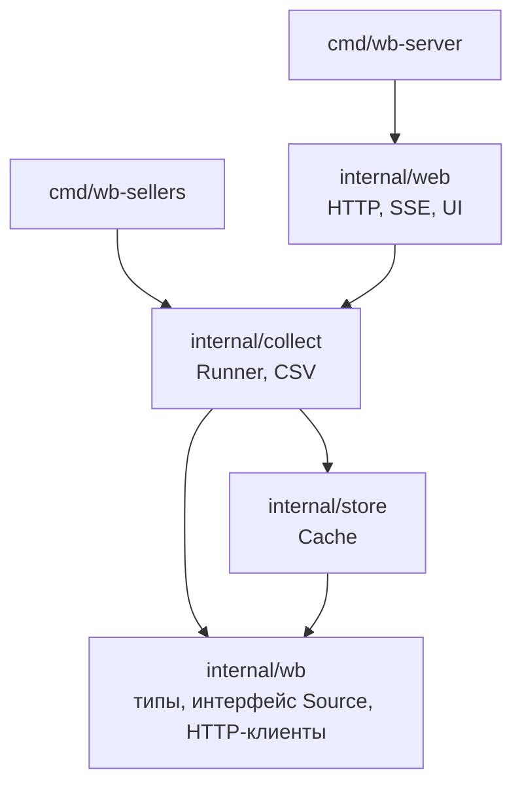
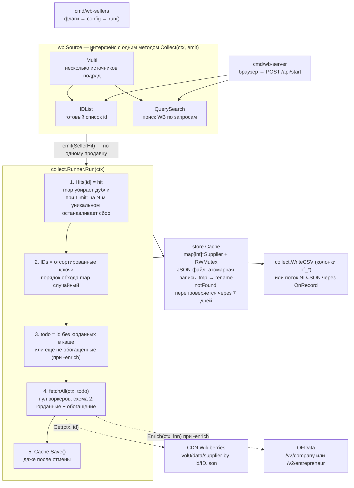
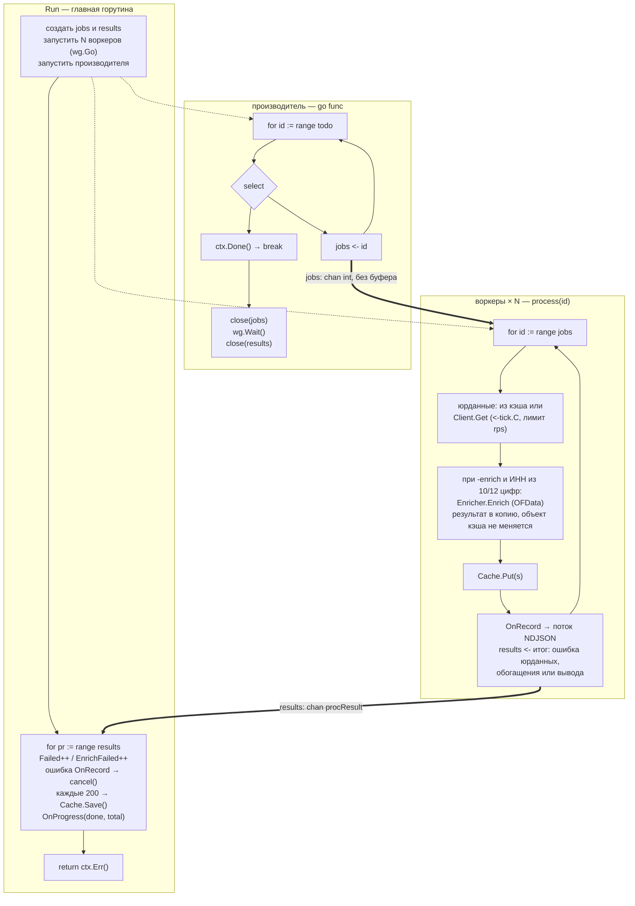
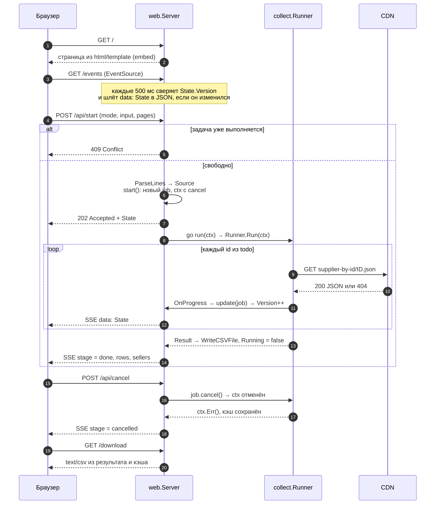
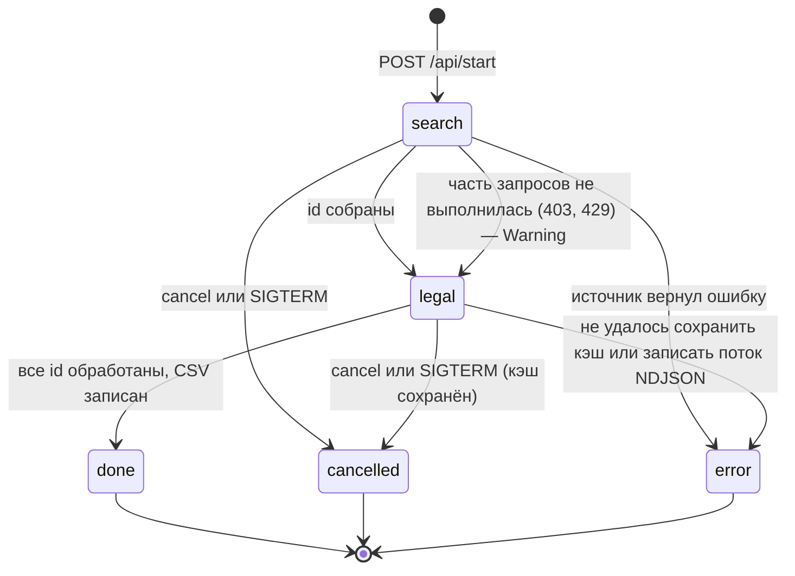
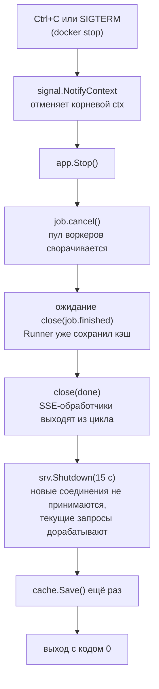
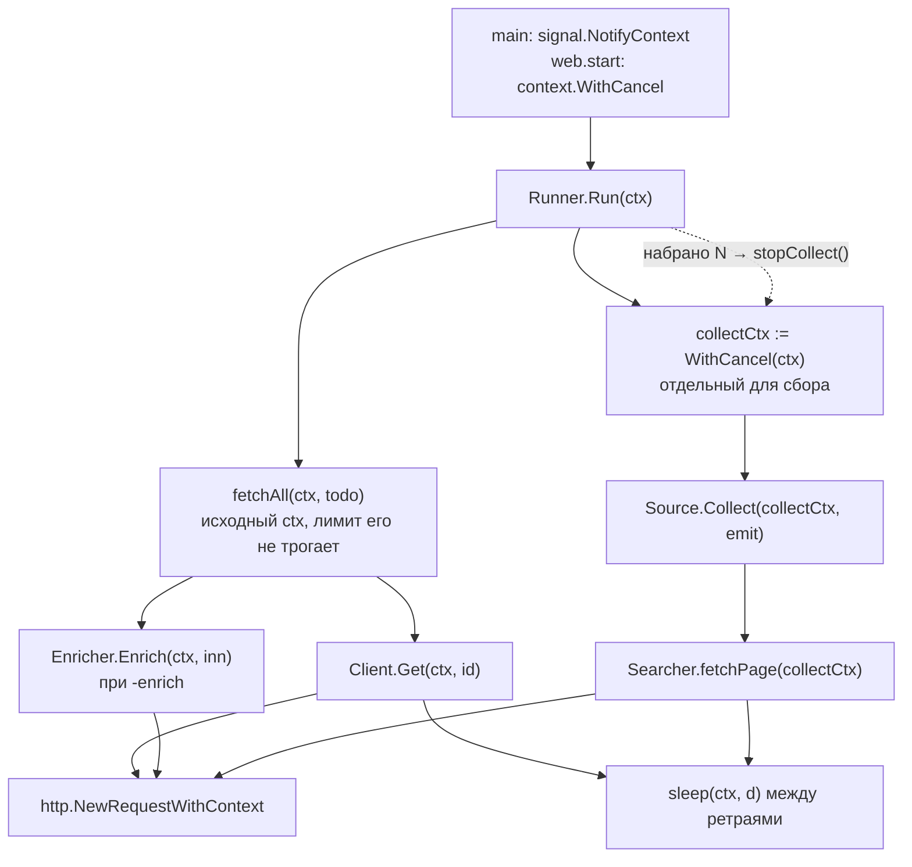

# wb-sellers

Собирает юридические данные продавцов Wildberries: название, ИНН, ОГРН, КПП, адрес.
Источник данных — публичный CDN WB, который отдаёт JSON по `supplierId`
(`static-basket-01.wbbasket.ru/vol0/data/supplier-by-id/{id}.json`, каталог всегда `vol0`).
Откуда брать сами `supplierId`, решает подключаемый источник: готовый список, поиск по запросам или что-то своё.

Типичный сценарий: задаёшь список id или поисковые запросы (категории) и, по желанию,
сколько продавцов нужно (`-limit`). На выходе юрданные этих продавцов, при желании
обогащённые из реестра ЕГРЮЛ/ЕГРИП через OFData (`-enrich`).

Два бинарника на одном ядре:

- `wb-sellers` — CLI: список id или запросы на входе, CSV или поток NDJSON на выходе.
- `wb-server` — веб-интерфейс: вставил ввод, нажал «Запустить», смотришь прогресс, скачиваешь CSV.
  Обогащение OFData в нём пока не включается, это только CLI.

## Структура проекта

```
cmd/wb-sellers/      CLI: флаги, сигналы, вызов конвейера
cmd/wb-server/       HTTP-сервер: точка входа, graceful shutdown
cmd/wb-search/       сбор supplierId из каталога витрины через headless-браузер (go-rod)
internal/wb/         предметная область: Source, SellerHit, Supplier, HTTP-клиенты
internal/store/      Cache: память + JSON-файл, безопасен для горутин
internal/collect/    конвейер Runner: источник → пул воркеров → CSV/NDJSON
internal/ofdata/     обогащение из реестра OFData (ЕГРЮЛ/ЕГРИП)
internal/web/        HTTP-обработчики, SSE, страница (html/template + embed)
Dockerfile           multi-stage, distroless, итоговый образ ~17 МБ
.github/workflows/   CI: сборка, vet, тесты -race, golangci-lint, govulncheck, docker build
.golangci.yml        набор линтеров и осознанные исключения
```

Зависимости между пакетами направлены строго вниз, циклов нет.
Показаны только прямые рёбра: `cmd/*` и `web` импортируют ещё `store` и `wb`, но это уже следует из схемы.



## Как это работает

### 1. Поток данных целиком

Оба бинарника строят `wb.Source`, отдают его в `collect.Runner` и забирают результат.
Runner не знает, откуда пришли id, а источник не знает, что с ними будет дальше.



### 2. Пул воркеров внутри `fetchAll`

Три роли и два канала. Главная горутина создаёт каналы и ждёт результаты.
Производитель кладёт id в `jobs`. Воркеры читают `jobs`, ходят в сеть и пишут в `results`.



Почему это не зависает при отмене: производитель видит `ctx.Done()`, перестаёт класть в `jobs` и закрывает его.
Воркеры дочитывают канал до конца и выходят из `range`. `wg.Wait()` отпускает производителя, тот закрывает `results`,
и цикл `range results` в главной горутине завершается сам. Ни один `send` не остаётся без получателя.
Объекты в кэше после `Put` не меняются: воркер, дописывающий обогащение, кладёт копию. Иначе `Cache.Save`,
который читает кэш из главной горутины, гонялся бы с воркерами за одно и то же поле.

### 3. Веб-сервер: один запуск задачи глазами браузера



### 4. Состояния задачи

Это поле `State.Stage`, которое видит интерфейс.



### 5. Остановка сервера без потери данных

Порядок важен: сначала гасится задача, потом освобождаются SSE-потоки, и только потом сервер перестаёт принимать соединения.
Иначе `Shutdown` ждал бы вечно открытые `/events`.



### 6. Один `ctx` на всё

Корневой `ctx` создаётся один раз наверху. Отмена в любой точке доходит до каждого
`select`, каждого `sleep` и каждого HTTP-запроса. У этапа сбора свой дочерний
`collectCtx`: при достижении `-limit` его отменяют, и сбор останавливается, а этап
юрданных на исходном `ctx` не прерывается. Родительский `ctx` (Ctrl+C, SIGTERM)
гасит оба.



## Запуск

```bash
# CLI: список id или ссылок на продавца, по одному на строку
go run ./cmd/wb-sellers -ids ids.txt -out out/sellers.csv

# Поиск по запросам (категориям) с остановкой на 100 уникальных продавцах
go run ./cmd/wb-sellers -queries queries.txt -profile windows-chrome152.json -limit 100

# Веб-интерфейс на http://localhost:8080
go run ./cmd/wb-server

# Docker
docker build -t wb-server .
docker run --rm -p 8080:8080 -v "$PWD/out:/data" wb-server
```

Файл `ids.txt` принимает голые числа и ссылки вида `https://www.wildberries.ru/seller/12345`,
а также CSV с колонкой `supplier_id`: вывод `wb-search` подаётся в `-ids` как есть.
В репозитории лежит пример с четырьмя продавцами: без российского ИНН, юрлицо, ИП и
отсутствующий на CDN, чтобы одним запуском проверить все ветки, включая `-enrich`.
Файл `queries.txt` — поисковые запросы, по одному на строку.
Строки, начинающиеся с `#`, пропускаются. Флаг `-limit N` останавливает сбор на N уникальных продавцах.

Полный список флагов: `go run ./cmd/wb-sellers -h` и `go run ./cmd/wb-server -h`.

### Доступ к серверу

По умолчанию сервер слушает `127.0.0.1:8080`, то есть доступен только с этой машины.
Он принимает запросы с Host `localhost`, loopback-адресов и имён, заданных через `-allowed-hosts`.
Это защищает от CSRF и DNS-rebinding. Чтобы открыть сервер по сети или по домену:

```bash
go run ./cmd/wb-server -addr :8080 -allowed-hosts sellers.local,10.0.0.5:8080
```

Запуск в Docker через `-p 8080:8080` и обращение по `localhost:8080` работает без настройки.

Образ работает от пользователя `nonroot` (uid 65532), каталог `/data` в образе уже принадлежит ему,
поэтому именованные и анонимные тома работают сразу. При bind-mount на Linux каталог на хосте
должен быть доступен этому uid на запись: `chown 65532 out` или `docker run --user "$(id -u)" ...`.

## Разработка

```bash
go test -race ./...     # тесты с детектором гонок
go vet ./...            # статический анализ
gofmt -l .              # должно быть пусто
golangci-lint run ./... # линтеры из .golangci.yml (нужен golangci-lint v2)
govulncheck ./...       # известные уязвимости в toolchain и зависимостях
```

То же самое запускает CI на каждый push и pull request (`.github/workflows/ci.yml`),
плюс проверяет, что Docker-образ собирается. Версия Go зафиксирована строкой
`toolchain` в `go.mod` и совпадает с базовым образом в Dockerfile.

Тесты не ходят в сеть: CDN, поисковый API и OFData подменяются `httptest.NewServer`,
кэш живёт в `t.TempDir()`. `Searcher` в тестах работает с настоящим профилем site-mimic,
но по обычному HTTP в сторону тестового сервера.

## Свой источник продавцов

Любой тип с методом `Collect(ctx context.Context, emit func(wb.SellerHit)) error` подходит как `wb.Source`.
В CLI он добавляется в слайс `sources` в `cmd/wb-sellers/main.go`,
в сервере — в замыкание `NewSearch` в `cmd/wb-server/main.go`.
Контракт: вызывать `emit` синхронно и возвращать `ctx.Err()`, как только контекст отменён.
Если источник отдаёт целую страницу за раз и проверяет `ctx` только между страницами,
`Runner` сам отбросит всё лишнее после `-limit`.

## Сбор id из каталога (cmd/wb-search)

Отдельная команда, которая открывает каталог витрины в браузере (go-rod)
и собирает товары по запросу, выводя их в CSV с колонкой `supplier_id`. Нужна, когда
продавцов берут по категории, а не по готовому списку id, и когда поисковый API
отвечает 403. Это самостоятельный инструмент, он не входит в основной конвейер,
но его CSV подаётся в `wb-sellers -ids` и в поле ввода `wb-server` без переделки.
Использование подчиняется правилам Wildberries.

Сценарий «N продавцов по запросу» целиком:

```bash
go run ./cmd/wb-search -q "кроссовки мужские" -pages 3 -out out/search.csv
go run ./cmd/wb-sellers -ids out/search.csv -limit 50 -out out/sellers.csv
open out/sellers.csv
```

Первая команда открывает окно браузера и собирает три страницы каталога (до 300 товаров,
продавцы в них повторяются). Вторая берёт из CSV колонку `supplier_id`, останавливается
на 50 уникальных продавцах и пишет их юрданные. Тот же CSV можно вставить в поле ввода
веб-интерфейса, поле «хватит продавцов» действует и для списка id.

## Если поиск не отвечает

Поисковый API может ответить 403, 429 или 498 (JS-проверка). Запрос с 429 повторяется с ротацией
шарда, остальные пропускаются, и прогон идёт дальше с тем, что собрано. Это не ошибка, а
предупреждение: в вебе оно показывается под прогрессом (`State.Warning`), в CLI печатается
строкой `прогон завершён с предупреждением` в конце. «Готово, 0 продавцов» без предупреждения
означает, что источник действительно ничего не вернул.

## Остановка по количеству

Флаг `-limit N` (в вебе — поле «хватит продавцов», для обоих режимов) останавливает сбор, как только
набрано `N` уникальных продавцов, и дальше качает юрданные только по ним. Это и есть
сценарий «дай N продавцов из категории»: источник листает витрину, `Runner` считает
уникальные `supplierId`, на N-м отменяет контекст сбора, источник видит `ctx.Err()`
и выходит. Контекст юрданных отдельный, поэтому второй этап не прерывается.
Повторяющиеся `supplierId` (у продавца много товаров) схлопываются в map, лишних
запросов к CDN нет.

## Обогащение из реестра (OFData)

Юрданные с CDN WB дают ИНН. Флаг `-enrich` по этому ИНН дотягивает из ЕГРЮЛ/ЕГРИП
через [OFData](https://ofdata.ru) статус, дату регистрации, полное наименование,
адрес, основной ОКВЭД и руководителя. Эндпоинт выбирается по длине ИНН: 10 цифр —
юрлицо, 12 — ИП.

```bash
export OFDATA_KEY=...            # ключ только из окружения, в коде его нет
go run ./cmd/wb-sellers -ids ids.txt -enrich            # обогащать юрлица
go run ./cmd/wb-sellers -ids ids.txt -enrich -enrich-ip # и ИП тоже
```

- `-enrich` включает обогащение, `-enrich-ip` добавляет к нему ИП (по умолчанию ИП пропускаются).
- Ключ берётся из `OFDATA_KEY` или флага `-ofdata-key`. В репозиторий ключ не коммитится.
- Обогащается только российский ИНН из 10 или 12 цифр. У продавцов из Беларуси и Казахстана
  вместо ИНН УНП/БИН, в ЕГРЮЛ их нет, поэтому запрос к OFData за них не уходит.
- Обогащение кэшируется вместе с юрданными (`Supplier.Enrich`), повторный запуск не платит за него снова.
  Ответ «в реестре нет» тоже кэшируется (`Enrichment.NotFound`): это такой же платный ответ.
- Ошибка API (баланс исчерпан, неверный запрос) в кэш не пишется и считается в `enrichFailed`
  итогового лога; следующий прогон попробует снова. Юрданные при этом сохраняются.
- Отклонённый ключ (401/403) останавливает весь прогон с ошибкой (код выхода 1), а не
  повторяет обречённый запрос для каждого продавца. Юрданные, полученные к этому моменту,
  уже в кэше: после исправления ключа повторный запуск обогатит их без походов на CDN.
- В CSV добавляются колонки `of_*`; в NDJSON — вложенный объект `enrich`.
- У продавцов-физлиц CDN отдаёт `sellerType: C2C` без ИНН; это поле есть в CSV и NDJSON,
  обогащать таких некого.

## Кэш и повторные запуски

Кэш `cache.json` хранит юрданные и обогащение, повторный запуск не ходит в сеть за тем, что
уже есть. Ответ CDN «нет такого продавца» тоже кэшируется с датой и перепроверяется через
7 дней (`Runner.NotFoundTTL`): продавец мог появиться позже. Пометки `notFound` без даты
остались от версии с неверным путём CDN и при загрузке удаляются, об этом пишется в лог.

## Форматы вывода: файл или поток

`-format csv` (по умолчанию) собирает всё и пишет отсортированный CSV в `-out` файл.
`-format ndjson` отдаёт по одному JSON-объекту на строку **по мере готовности** продавца.
Если `-out` не задан, файл называется `out/sellers.csv` или `out/sellers.ndjson` по формату.
CSV пишется во временный файл и переименовывается, поэтому по пути `-out` не бывает недописанного файла.

Для обработки другим приложением в реальном времени — NDJSON в stdout:

```bash
go run ./cmd/wb-sellers -ids ids.txt -enrich -format ndjson -out - | ваше-приложение
```

Логи идут в stderr, данные в stdout, поэтому поток не загрязняется. Каждая запись
появляется сразу, как только продавец получен и обогащён, ждать конца не нужно.
Если поток вывода сломался (читающий процесс завершился, диск кончился), прогон
останавливается с ошибкой, а не продолжает молча ходить в сеть: всё полученное к этому
моменту уже лежит в кэше. Это касается и `| head`: SIGPIPE в `wb-sellers` игнорируется,
поэтому закрытый пайп превращается в обычную ошибку записи, а не убивает процесс.
