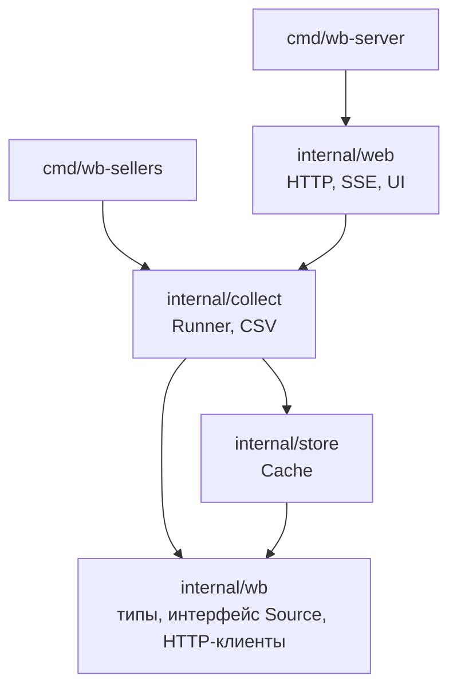
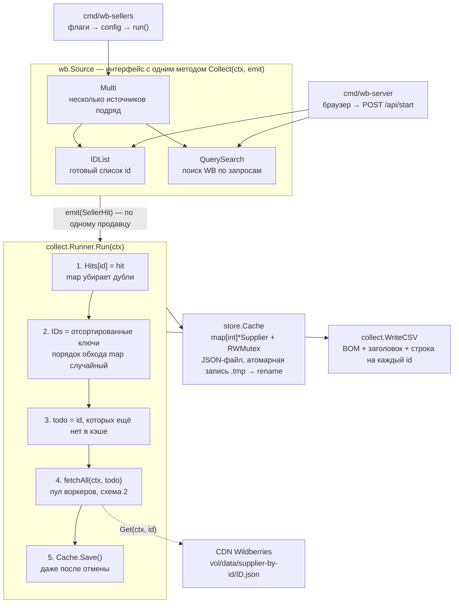
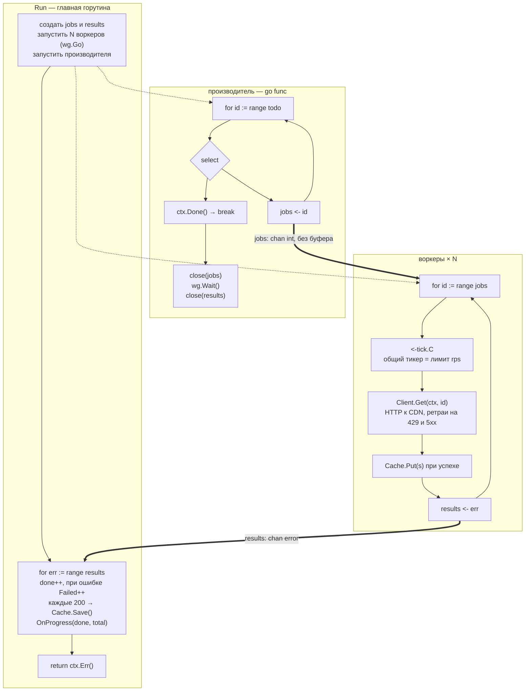
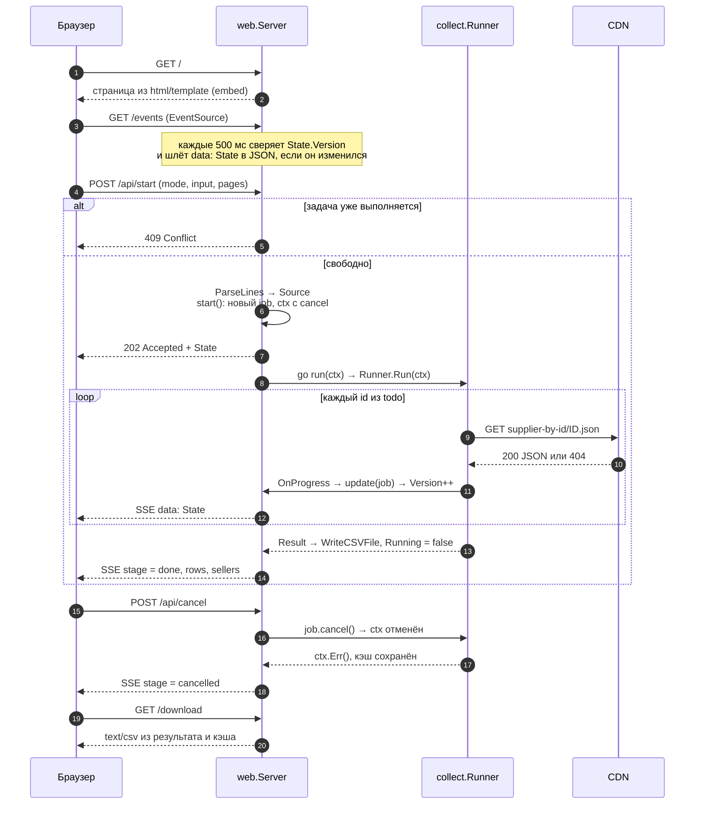
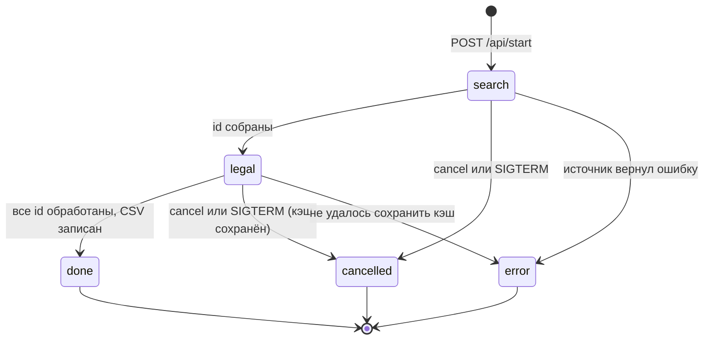
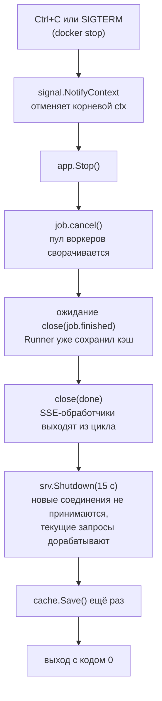
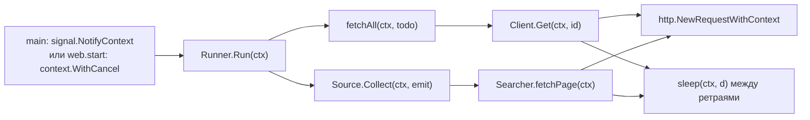

# wb-sellers

Собирает юридические данные продавцов Wildberries: название, ИНН, ОГРН, КПП, адрес.
Источник данных — публичный CDN WB, который отдаёт JSON по `supplierId`.
Откуда брать сами `supplierId`, решает подключаемый источник: готовый список, поиск по запросам или что-то своё.

Два бинарника на одном ядре:

- `wb-sellers` — CLI: файл со списком на входе, CSV на выходе.
- `wb-server` — веб-интерфейс: вставил список, нажал «Запустить», смотришь прогресс, скачиваешь CSV.

## Структура проекта

```
cmd/wb-sellers/      CLI: флаги, сигналы, вызов конвейера
cmd/wb-server/       HTTP-сервер: точка входа, graceful shutdown
internal/wb/         предметная область: Source, SellerHit, Supplier, HTTP-клиенты
internal/store/      Cache: память + JSON-файл, безопасен для горутин
internal/collect/    конвейер Runner: источник → пул воркеров → CSV
internal/web/        HTTP-обработчики, SSE, страница (html/template + embed)
Dockerfile           multi-stage, distroless, итоговый образ ~17 МБ
```

Зависимости между пакетами направлены строго вниз, циклов нет.
Показаны только прямые рёбра: `cmd/*` и `web` импортируют ещё `store` и `wb`, но это уже следует из схемы.



## Как это работает

### 1. Поток данных целиком

Оба бинарника строят `wb.Source`, отдают его в `collect.Runner` и забирают результат.
Runner не знает, откуда пришли id, а источник не знает, что с ними будет дальше.



### 2. Пул воркеров внутри `fetchAll`

Три роли и два канала. Главная горутина создаёт каналы и ждёт результаты.
Производитель кладёт id в `jobs`. Воркеры читают `jobs`, ходят в сеть и пишут в `results`.



Почему это не зависает при отмене: производитель видит `ctx.Done()`, перестаёт класть в `jobs` и закрывает его.
Воркеры дочитывают канал до конца и выходят из `range`. `wg.Wait()` отпускает производителя, тот закрывает `results`,
и цикл `range results` в главной горутине завершается сам. Ни один `send` не остаётся без получателя.

### 3. Веб-сервер: один запуск задачи глазами браузера



### 4. Состояния задачи

Это поле `State.Stage`, которое видит интерфейс.



### 5. Остановка сервера без потери данных

Порядок важен: сначала гасится задача, потом освобождаются SSE-потоки, и только потом сервер перестаёт принимать соединения.
Иначе `Shutdown` ждал бы вечно открытые `/events`.



### 6. Один `ctx` на всё

Контекст создаётся один раз наверху и передаётся вниз первым аргументом через каждую функцию.
Отмена в любой точке доходит до каждого `select`, каждого `sleep` и каждого HTTP-запроса.



## Запуск

```bash
# CLI: список id или ссылок на продавца, по одному на строку
go run ./cmd/wb-sellers -ids ids.txt -out out/sellers.csv

# Веб-интерфейс на http://localhost:8080
go run ./cmd/wb-server

# Docker
docker build -t wb-server .
docker run --rm -p 8080:8080 -v "$PWD/out:/data" wb-server
```

Файл `ids.txt` принимает голые числа и ссылки вида `https://www.wildberries.ru/seller/12345`.
Строки, начинающиеся с `#`, пропускаются.

Полный список флагов: `go run ./cmd/wb-sellers -h` и `go run ./cmd/wb-server -h`.

### Доступ к серверу

По умолчанию сервер слушает `127.0.0.1:8080`, то есть доступен только с этой машины.
Он принимает запросы с Host `localhost`, loopback-адресов и имён, заданных через `-allowed-hosts`.
Это защищает от CSRF и DNS-rebinding. Чтобы открыть сервер по сети или по домену:

```bash
go run ./cmd/wb-server -addr :8080 -allowed-hosts sellers.local,10.0.0.5:8080
```

Запуск в Docker через `-p 8080:8080` и обращение по `localhost:8080` работает без настройки.

## Разработка

```bash
go test -race ./...     # тесты с детектором гонок
go vet ./...            # статический анализ
gofmt -l .              # должно быть пусто
```

Тесты не ходят в сеть: CDN подменяется `httptest.NewServer`, кэш живёт в `t.TempDir()`.

## Свой источник продавцов

Любой тип с методом `Collect(ctx context.Context, emit func(wb.SellerHit)) error` подходит как `wb.Source`.
В CLI он добавляется в слайс `sources` в `cmd/wb-sellers/main.go`,
в сервере — в замыкание `NewSearch` в `cmd/wb-server/main.go`.
Контракт: вызывать `emit` синхронно и возвращать `ctx.Err()`, как только контекст отменён.
